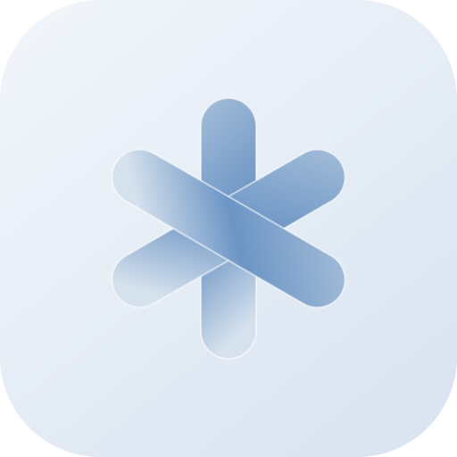
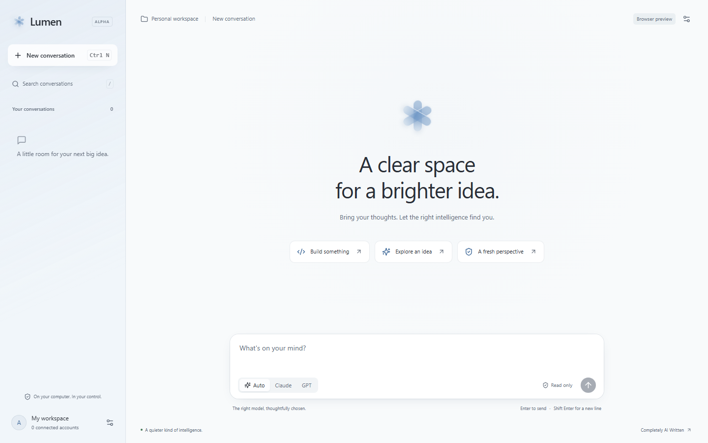
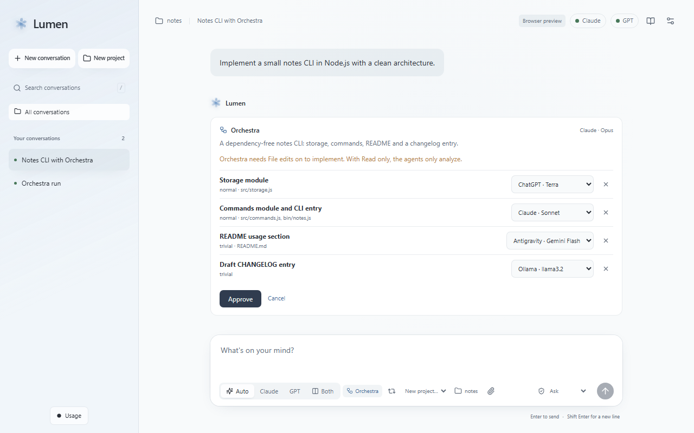
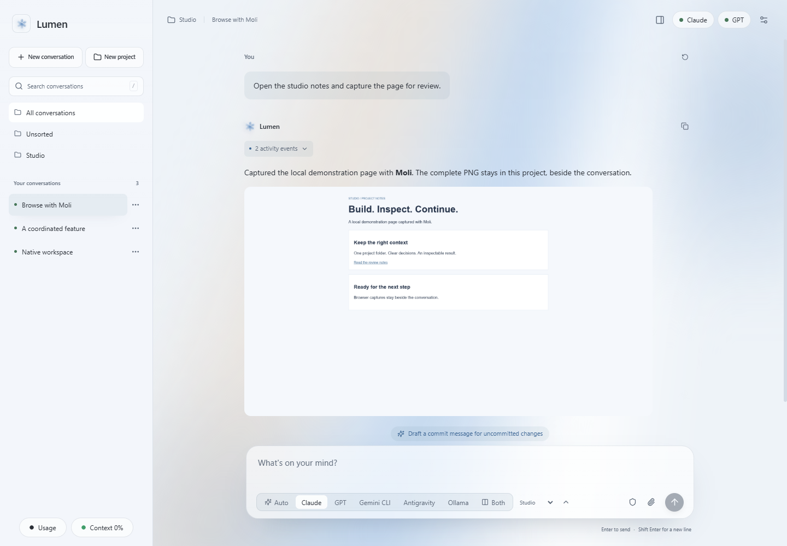
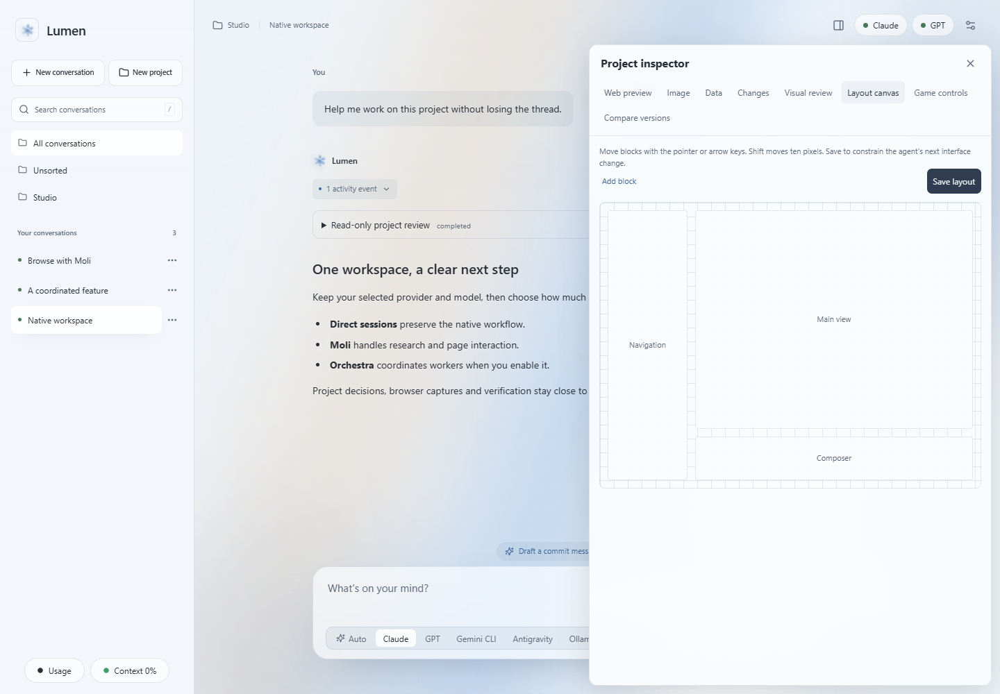

<div align="center">
  
  <h1>Lumen</h1>
  <p><strong>Il tuo spazio di lavoro AI. Sessioni native. Un browser per gli agenti.</strong></p>
  <p>Claude Code · Codex · Gemini CLI · Antigravity · Ollama</p>
  <p><a href="https://github.com/Andrea17982/Lumen/releases/latest">Scarica la 0.8.0</a> · <a href="docs/README.md">Documentazione</a> · <a href="README.md">English</a></p>
</div>



*Schermata dell'app Windows con dati dimostrativi. Le immagini rappresentano l'interfaccia implementata, non un benchmark dei modelli.*

Lumen riunisce le conversazioni AI sul tuo computer. Scegli provider e modello, continua la sessione nativa e lavora nella cartella corretta. Attiva **Orchestra** quando serve una squadra coordinata. **Moli** gestisce navigazione e ricerca web con ogni provider.

Tauri 2, core Rust, React e TypeScript. Interfaccia in italiano e inglese, temi chiaro/scuro, conversazioni locali e autenticazione ufficiale dei provider. La 0.8 resta una versione alpha di un progetto indipendente, con limiti espliciti sulle integrazioni e sulle piattaforme verificate.

## 0.8 — Continuità, strumenti condivisi e Liquid Glass

Continuità più sicura fra account, avanzamento e consenso dei connettori più chiari, recupero Auto/Orchestra e miglioramenti mirati a contesto e grafo. Il logo apre la sidebar di vetro; permessi spiegati e un breve tutorial introducono l'app. Catalogo MCP/skill, gateway Codex del proprietario ed esecuzione locale stdio/Streamable HTTP estendono le integrazioni supportate. **La portabilità universale non è consegnata:** connettori cloud proprietari, hook/mods nativi e formati non supportati restano nella roadmap successiva. [Novità e limiti della 0.8](docs/release-notes/0.8.0.md).

## Funzioni dell'applicazione

| Lavorare con continuità | Strumenti vicini al progetto |
| --- | --- |
| Sessioni dirette predefinite, con provider e modello scelti dall'utente. | Moli incluso e configurato automaticamente, anche nei worker Orchestra. |
| Domande native con opzioni, attività e output degli agenti figli. | Inspector, zoom/griglia immagini, JSON/SQLite e canvas dei layout. |
| Autopilot senza ripetere le approvazioni dei piani già autorizzati. | Merge manuale di Both e confronto delle varianti statiche nei worktree. |
| Resume nativo Claude/Codex, memoria del lavoro e cambio esplicito della cartella. | Diagnostica, controlli sui progetti interessati e integrazione Godot opzionali. |
| Continuità tramite area di notifica. | Pacchetti Windows, macOS universale e Linux. |

[Changelog 0.8](docs/release-notes/0.8.0.md) · [Guida alle funzioni](docs/features.md) · [Evidenze della release](docs/release-readiness-0.8.md). Le misure prestazionali e le versioni precedenti restano nella [cronologia](docs/release-notes/README.md).

## Scegli come lavorare

**Sessione diretta.** Seleziona Claude, GPT/Codex, Gemini CLI, Antigravity oppure Ollama. Account, modello e ragionamento provengono dai cataloghi disponibili. Claude usa lo stream nativo bidirezionale e Codex app-server; i provider Google mantengono le CLI ufficiali. Ollama usa l'API ufficiale sul computer.

**Auto.** Affida a Lumen la selezione da catalogo con preferenze Budget, Default o Quality ed eventuale revisione indipendente. I passaggi aggiuntivi consumano quota.

**Orchestra.** Attiva esplicitamente l'orchestratore per attività più grandi: dipendenze, assegnazioni, worker in worktree Git separati, limiti, integrazione e recupero dei lavori interrotti. Autopilot e l'esecuzione già approvata non producono un altro ciclo di autorizzazione del piano.

**Both.** Confronta Claude e Codex affiancati in sola lettura. I risultati conservati nei worktree possono essere ispezionati e uniti con scelte per file e modifiche manuali dove applicabile.



## Navigazione con Moli

Moli si avvia quando viene chiamato uno strumento del browser. Offre lettura Markdown, ricerca, navigazione persistente, interazioni DOM e screenshot. I contesti sono separati per conversazione e worker.

Con Ollama, Lumen riceve le chiamate agli strumenti dall'API locale, esegue Moli e restituisce gli esiti allo stesso modello. È disponibile un formato JSON alternativo per modelli conversazionali senza function calling nativo. Nessuna chiave e nessuna inferenza Ollama remota.

Per evitare un blocco osservato nella CLI Antigravity con le immagini MCP inline, questa riceve il percorso del PNG originale per il proprio visualizzatore nativo; Lumen mostra l'immagine completa.



Moli non rende un modello automaticamente più intelligente e non garantisce accelerazioni esponenziali. CAPTCHA, compatibilità dei siti e limiti di rendering restano reali. [Architettura, misure e limiti](docs/moli.md).

## Dal contesto alla verifica



L'inspector affianca alla chat controlli di progetto, modifiche, anteprime locali, immagini e canvas dei layout. I controlli Godot sono opzionali e verificano il progetto connesso; gli addon acquistati non sono distribuiti con Lumen.

Il registro persistente del lavoro conserva requisiti e decisioni attraverso troncamento del contesto, Compact e Rewind. Le sessioni native inviano la nuova richiesta senza ripetere inutilmente tutta la conversazione. Le stime locali dei token restano distinte dai dati riportati dal provider.

## Scarica e avvia

I pacchetti sono in **[Releases](https://github.com/Andrea17982/Lumen/releases/latest)**:

- **Windows x64:** `Lumen_0.8.0_x64-setup.exe`, oppure `Lumen_0.8.0_x64-portable.zip`. Estrai **tutto** lo ZIP e conserva `resources` accanto a `Lumen.exe`.
- **macOS:** DMG universale per Intel e Apple silicon.
- **Linux x64:** DEB e AppImage, compilati su Ubuntu 24.04.

I pacchetti non sono firmati. Il rilascio include `SHA256SUMS.txt`. Installa separatamente le CLI ufficiali dei provider oppure Ollama con un modello locale; Moli è già incluso.

1. Apri **Settings → Accounts**, aggiungi un account e completa il login ufficiale. Ollama non richiede login.
2. Scegli la cartella del progetto e il provider diretto. Espandi i controlli per modello e ragionamento.
3. Seleziona i permessi e invia la richiesta. **Read only** è il permesso iniziale; **Autopilot** autorizza gli strumenti disponibili con il tuo account del sistema operativo.
4. Attiva Orchestra separatamente quando serve una squadra.

[Avvio e risoluzione dei problemi](docs/getting-started.md) · [Account](docs/accounts.md) · [Cartelle e permessi](docs/workspace-models-permissions.md)

## Compilazione

Servono Node.js 22.12+ o una versione supportata di Node 24, Rust stable e i [prerequisiti Tauri](https://v2.tauri.app/start/prerequisites/).

```sh
git clone https://github.com/Andrea17982/Lumen.git
cd Lumen
npm ci
npm run tauri dev
```

La build prepara automaticamente Moli con versione e checksum fissati. `npm run dev` apre una sola anteprima UI, senza login o inferenza. Su Windows `npm run build:release` genera installer e ZIP in `builds/latest/`. [Guida per sviluppatori](docs/development.md).

## Verifiche e confini

Il candidato 0.8 ha superato **203 test Rust Windows, 72 unitari frontend, 40 browser e 56 scenari nativi Windows**, oltre a formattazione/Clippy e controlli di versioni/documentazione. Gli scenari nativi usano dati isolati e fixture provider/API offline. Un probe separato verifica i metadati MCP con la CLI installata, senza inferenza. CI e controlli degli helper nei pacchetti coprono Windows, macOS e Linux.

Il registro live resta a 13 slot storici, senza nuove inferenze o login per questa chiusura. Restano limiti espliciti sulle prove desktop/accessibilità non Windows, sulla matrice account/versioni e sulla portabilità dei connettori proprietari. Fixture e build non sostituiscono tali verifiche. [Perimetro ed evidenze 0.8](docs/release-readiness-0.8.md) · [Supporto integrazioni](docs/shared-capabilities-0.8.md) · [Roadmap successiva](docs/roadmap-next.md).

Autopilot concede accesso ampio. Lumen non aggiunge una gabbia OS comune e non cifra internamente il database; usa permessi del sistema e cifratura del disco. Non sostituisce le politiche dei provider. [Sicurezza](SECURITY.md).

## Completamente AI Written

Codice, interfaccia, test e documentazione sono **completamente AI Written**, generati da AI sotto la direzione di Andrea. Visione e decisioni sono umane. È una dichiarazione di provenienza, non un audit indipendente.

> Grazie a chi vorrà provare Lumen e raccontare come si trova. Feedback, segnalazioni e idee sono benvenuti! — Andrea

Licenza MIT. Per il feedback usa le [Issues](https://github.com/Andrea17982/Lumen/issues). Il [sostegno PayPal facoltativo](https://www.paypal.com/cgi-bin/webscr?cmd=_donations&business=andreanastrobusiness1999%40gmail.com&currency_code=EUR&item_name=Support%20Lumen) va a **andreanastrobusiness1999@gmail.com** e non sblocca funzioni.

[Documentazione](docs/README.md) · [Architettura](docs/architecture.md) · [Contribuire](CONTRIBUTING.md) · [Licenze terze parti](THIRD_PARTY_NOTICES.md)
