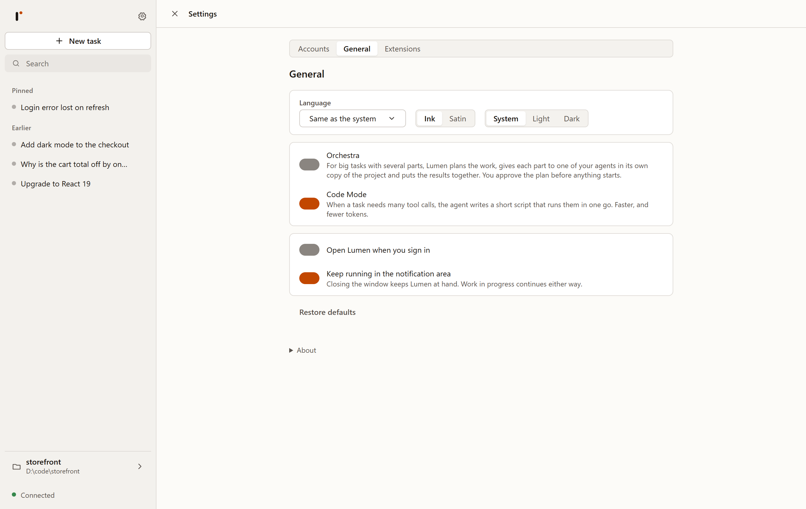
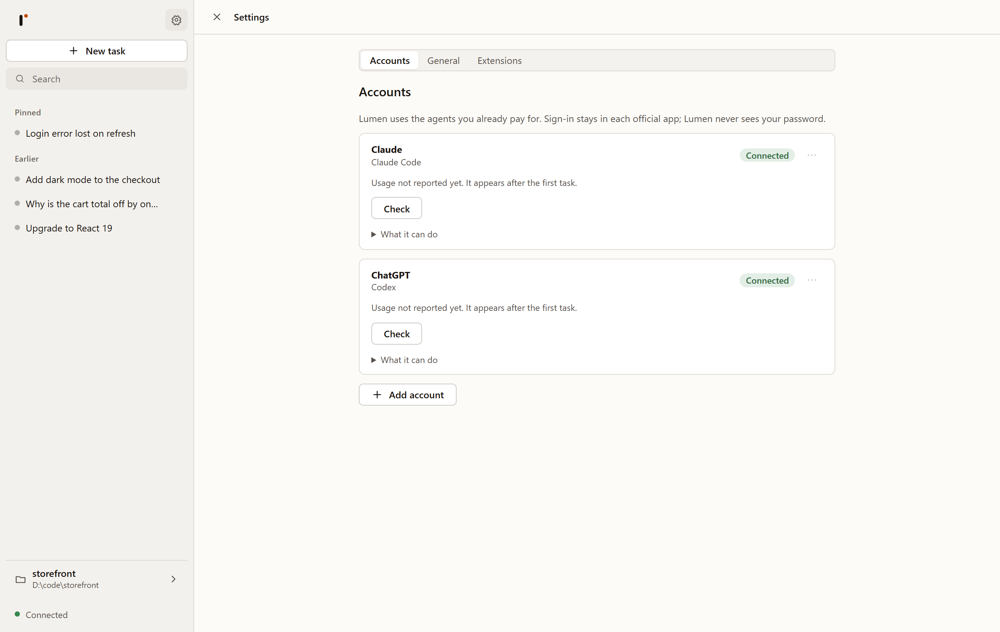

  
  <h1>Lumen</h1>
  
<strong>L'ennesimo aggregatore di AI Subscriptions. Stavolta con stile e un'auto mode.</strong>

  

    <a href="https://github.com/Andrea17982/Lumen/releases/latest">Download</a> ·
    <a href="docs/README.md">Documentazione (EN)</a> ·
    <a href="README.md">English</a>
  

<picture>
  <source media="(prefers-color-scheme: dark)" srcset="docs/images/conversation-dark.png">
  
</picture>

Vi spiego subito perché mai è nato Lumen. Pago Claude, ChatGPT e un paio di altre cose, e mi ero stancato di decidere quale applicazione aprire, quale configurare e come gestire lo stesso progetto su due app con sessioni diverse quando puntualmente finivo i Token. Lumen è quello che volevo al posto di tutto questo e che purtroppo non ho avuto da altre app concorrenti.

Non voglio stare a cambiare settaggi su settaggi, e non voglio andare a dover scegliere per ogni singola task quale modello usare, quale effort, centellinare i miei token e pensare a cosa sia meglio affidare a chi, con la paura costante di usare contesto non in cache e bruciare l'utilizzo in pochi minuti. Provatelo, e se non vi piace disinstallatelo, o magari fatene una vostra fork, modificatelo, mandate Pull Request, aprite Issues, a voi la scelta!

È gratuito, con licenza MIT, ed è ancora in alpha.

## Cosa fa

- **Sceglie l'agente al posto tuo.** Il migliore disponibile in quel momento per la vostra richiesta; se una quota finisce, ne continua un altro senza rifare quello che era già finito. Gli agenti comunicano fra loro facilmente evitando di dover creare continui handoff tra le app proprietarie.
- **Si ferma quando deve.** Proprio come le CLI native, ha un sistema di permessi che ti consente di gestire gli agenti in sola lettura, in edits con approvazioni, o col pilota automatico.
- **I task grandi vengono divisi.** Seguendo la filosofia del "non voglio doverlo fare io", il motore interno di Lumen valuta la complessità di una Task e decide se assegnarla a diversi agenti parallelamente, anche da subscription diverse.
- **Si ricorda del progetto.** Le decisioni finiscono in `LUMEN.md`, che ogni agente legge. Questo file punta a fare da memoria condivisa rimpiazzando le molteplici cartelle per Claude, Codex ecc... creando un'unica fonte di verità.
- **Continua a lavorare.** Chiudi la finestra e il lavoro va avanti in background. O magari preferite che l'applicazione venga chiusa e non finisca nella Notification Tray, a voi la scelta.

Due cose sono semplici interruttori nelle Impostazioni, ognuno con una riga di spiegazione:
- **Orchestra**, che divide un task grande tra i tuoi agenti dopo che hai approvato il piano
- **Code Mode**, che trasforma molte chiamate ai tool in un solo script per risparmiare token. Mutuata direttamente dall'ultimo aggiornamento sperimentale di Anthropic, mutuandola per ogni abbonamento (dove i miei benchmark hanno mostrato risultati soddisfacenti).

Sotto il cofano ci sono anche tante modifiche e migliorie che non ho scritto rispetto all'utilizzo con le CLI native, come l'utilizzo del browser Moli per ottimizzare il consumo di Token nel caso di navigazione Web.

## Download

Consulta la [release 0.12.6](https://github.com/Andrea17982/Lumen/releases/tag/v0.12.6) per i pacchetti disponibili e i checksum SHA-256. La distribuzione prevede Windows x64 (setup e portable), macOS universale e Linux x64 (Debian e Ubuntu). Windows può mostrare un avviso perché i pacchetti non sono firmati.

## Da sapere

Autopilota dà agli agenti un accesso ampio al computer e non è una sandbox. Lumen non tocca le credenziali dei provider: ogni CLI fa il login da sé, e le chiavi API finiscono nel portachiavi di sistema. [Validazione](docs/validation.md) · [Sicurezza](SECURITY.md)

## Come è fatto

Codice, test e documentazione li scrive Claude Code sotto la mia direzione; le decisioni di prodotto sono mie. È una dichiarazione, non un audit di sicurezza.

Grazie a **Theo / pingdotgg, T3 Tools Inc. e ai contributor di T3 Code**: Lumen adatta parti del design di T3 Code. [Fonti e modifiche](src-tauri/resources/legal/t3code/ADAPTATIONS.md) · [Licenze](THIRD_PARTY_NOTICES.md). Ciò non implica alcun endorsement.

Bug e idee nelle [Issues](https://github.com/Andrea17982/Lumen/issues). Se vuoi sostenerlo c'è [PayPal](https://www.paypal.com/cgi-bin/webscr?cmd=_donations&business=andreanastrobusiness1999%40gmail.com&currency_code=EUR&item_name=Support%20Lumen); non sblocca nulla. — Andrea

MIT © 2026 Andrea17982. Non affiliato con Anthropic, OpenAI, Google o con gli altri provider citati.
