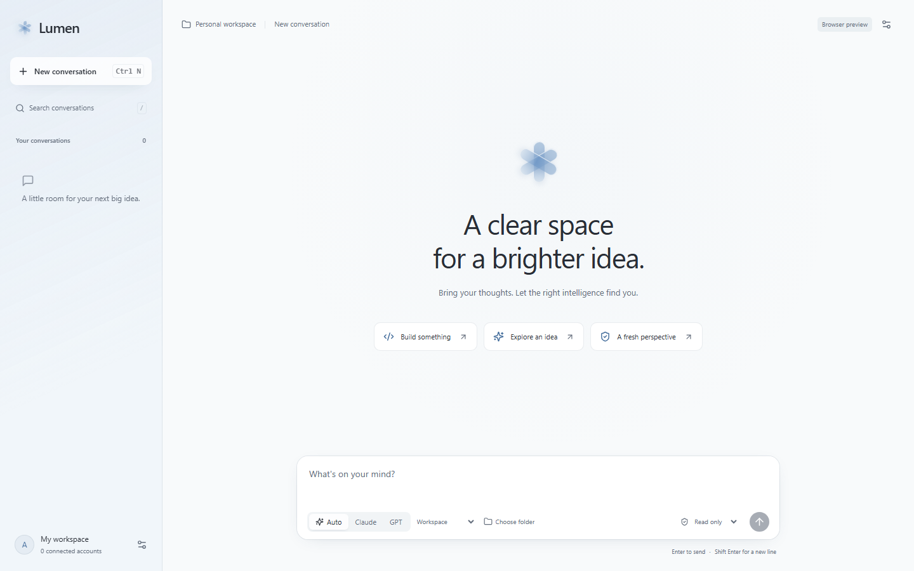

<div align="center">
  
  <h1>Lumen</h1>
  <p>A clear space for a brighter idea.</p>
  <p>A local desktop workspace for Claude Code and ChatGPT / Codex.<br/>Tauri 2 · Rust · React · TypeScript</p>
  <p><a href="https://github.com/Andrea17982/Lumen/releases">Download</a> · <a href="docs/getting-started.md">Get started</a> · <a href="docs/architecture.md">Architecture</a> · <a href="README.it.md">Italiano</a></p>
  
  
  <p><a href="https://www.paypal.com/cgi-bin/webscr?cmd=_donations&amp;business=andreanastrobusiness1999%40gmail.com&amp;currency_code=EUR&amp;item_name=Support%20Lumen"></a></p>
</div>



Also see the [model, workspace and permission controls](docs/images/provider-controls-fixture.png), [dark theme](docs/images/dark.png) and a [native chat capture using explicitly labeled offline fixtures](docs/images/chat-fixture.png).

Lumen brings separate AI conversations into one restrained, glass-inspired desktop interface. Write a request, keep working across sessions, and let **Auto** choose an execution plan. Optional controls expose the provider, account, model and reasoning effort when you need them.

**Status: v0.2 alpha.** This is an initial, usable implementation with explicit boundaries. Provider availability, subscription terms, CLI compatibility and system resources still apply. It is an independent community project, unaffiliated with Apple, Anthropic or OpenAI.

## New in 0.2

A quieter interface with promotional footer labels removed; named workspaces and per-conversation folders beside the AI selector; account renaming in the composer and Settings; official CLI model/effort dropdowns; and an explicit Autopilot permission mode. See [workspace, models and permissions](docs/workspace-models-permissions.md).

## Completely AI Written

**Lumen's application code, interface, tests and documentation are completely AI Written**, generated by AI at the direction of Andrea ([Andrea17982](https://github.com/Andrea17982)). The original product brief and decisions are human. AI authorship is a disclosure, not a claim of independent security auditing or correctness.

> Thank you to everyone who wants to try Lumen and let me know how it feels to use. Your feedback, bug reports and ideas are very welcome. — Andrea

Try it, [tell us how it goes](https://github.com/Andrea17982/Lumen/issues), or contribute. It is free to download, use and modify under the MIT license.

## What works in this alpha

- Persistent SQLite conversations, automatic first-message titles, rename, pin, search, deletion and paginated loading. No hard-coded conversation-count limit.
- Independent concurrent sessions, with four active orchestration jobs and up to eight inference processes. Extra turns wait in a queue. File-writing turns in the same canonical workspace are serialized.
- English interface, light / dark / system appearance, keyboard shortcuts, accessible labels and reduced-motion support.
- Claude Code partial-text streaming; Codex JSONL activity and completed-message updates. Provider-exposed reasoning, tools, file changes and reviews appear in collapsible activity. Codex `exec --json` is not token-by-token text streaming.
- Multiple named accounts with isolated `CLAUDE_CONFIG_DIR` / `CODEX_HOME` directories. Official CLI sign-in opens in a terminal. Lumen does not implement its own OAuth flow, inspect tokens, copy existing logins or proxy provider traffic.
- **Auto** uses local, deterministic task heuristics to choose effort and a provider; complex tasks can use an independent reviewer, and comparison tasks can gather two perspectives in parallel before synthesizing.
- Read-only by default, with File edits and **Autopilot** permission profiles. Autopilot disables CLI approval prompts/sandbox restrictions and exposes the provider’s default tools and configured extensions under your OS account. No automatic account rotation or rate-limit bypass.
- An optional PayPal support button, in the app and here. Donations unlock nothing.

## Install and run

### Windows download

Get the Windows x64 installer from [Releases](https://github.com/Andrea17982/Lumen/releases). The alpha installer is unsigned; Windows may show a publisher warning. Lumen uses Microsoft Edge WebView2. The two provider CLIs are installed separately and remain unmodified.

1. Install [Claude Code](https://code.claude.com/docs/en/setup) and/or [Codex CLI](https://developers.openai.com/codex/cli).
2. Open Lumen → **Settings** → **Connected accounts** → **+**.
3. Add a name and provider, then choose **Sign in**. Complete the provider's login in its own terminal/browser flow.
4. Return to Lumen and choose the shield button to check the connection.
5. Choose a trusted workspace folder and send a message. **Auto** is selected by default.

Each person uses their own accounts and pays their provider directly. Access to models and CLI features depends on their plan. See [account requirements and limitations](docs/accounts.md), including Anthropic's rules for third-party products and credential use.

### From source

Prerequisites: Node.js 22.12+ (or supported Node 24), current stable Rust, Windows C++ Build Tools with a Windows SDK, WebView2, and at least one provider CLI on `PATH`. See [Tauri's prerequisites](https://v2.tauri.app/start/prerequisites/).

```powershell
git clone https://github.com/Andrea17982/Lumen.git
cd Lumen
npm ci
npm run tauri dev
```

Create an installer with `npm run tauri build`. A browser-only UI preview is available with `npm run dev`; **it does not connect accounts or generate AI responses**. Linux needs Tauri's system dependencies and `npm run tauri build -- --bundles deb,appimage`; terminal login launching is Windows-only in this alpha.

## Auto, honestly

Auto is an explainable local router, not a trained task classifier. Small requests prefer Codex with low reasoning; medium requests use medium reasoning; long requests and coding/security/architecture keywords prefer Claude Opus with high reasoning. Claude otherwise uses its `sonnet` alias; Codex uses the installed CLI's default model. If only one provider is configured, it uses that provider and a single-stage plan.

When both providers are configured, complex requests use writer → independent read-only reviewer → final answer. Comparison requests use two read-only perspectives in parallel → synthesis. These worker calls act as bounded sub-agents; they are **not** arbitrary recursive or native provider sub-agent spawning. Extra stages consume provider usage. Routing considers configured accounts, not live quotas or whether login has completed. See [Auto policy](docs/auto.md).

## Current limits

- Live paid inference, multi-account OAuth identity isolation and real provider file-edit behavior require user-driven acceptance testing. Local builds, mocked protocols or UI previews do not prove these flows.
- Conversation context is replayed to the CLI on each turn, capped at the most recent 100,000 characters. No native thread resume, semantic compaction, attachments, worktree management or permission-request UI yet.
- Read-only and File edits restrict provider tools; **Autopilot deliberately removes those restrictions**. It permits shell/network/filesystem operations and configured computer-automation tools, but does not supply a GUI automation engine or override OS/UAC/provider policy. Read-only is a provider permission mode, not an independent OS isolation boundary.
- Account-directory isolation is not proof that every CLI version uses no shared OS credential-store state. Verify with distinct test accounts before relying on it. Account removal deletes the local directory; remote token revocation remains the provider's responsibility.
- Stored conversations and CLI-owned credentials are local and **not encrypted by Lumen**. No telemetry is implemented in Lumen; the CLIs have their own network and privacy behavior.
- Instant startup and low memory are design targets, not published benchmark results. Inactive sessions do not keep an AI process alive.

## Documentation

| Guide | Contents |
| --- | --- |
| [Getting started](docs/getting-started.md) | Setup, first conversation, shortcuts, recovery |
| [Architecture](docs/architecture.md) | Rust modules, React components, storage, execution lifecycle |
| [Accounts](docs/accounts.md) | Official authentication, isolation, provider requirements |
| [Workspace, models & permissions](docs/workspace-models-permissions.md) | Conversation folders, account names, live CLI catalogs and Autopilot |
| [Auto](docs/auto.md) | Routing rules, review, parallel workers, costs and boundaries |
| [Design system](DESIGN.md) | Glass material, type, color, motion and accessibility |
| [Roadmap](docs/roadmap.md) | MVP → v1 → v2 and requirement-by-requirement status |
| [Development](docs/development.md) | Building, tests, release process, protocol fixtures |
| [Validation](docs/validation.md) | Observed checks and what remains unverified |
| [Security](SECURITY.md) | Data storage, trust boundaries and vulnerability reporting |
| [Contributing](CONTRIBUTING.md) | Feedback, code contributions and AI disclosure |

## Support the project

Feedback is already a contribution. If you'd also like to help support development, you can make an optional [PayPal donation](https://www.paypal.com/cgi-bin/webscr?cmd=_donations&business=andreanastrobusiness1999%40gmail.com&currency_code=EUR&item_name=Support%20Lumen) to **andreanastrobusiness1999@gmail.com**. PayPal handles the transaction; Lumen receives no payment credentials. This is a voluntary personal contribution, not a charitable tax-deductibility claim.

MIT © 2026 Andrea17982. Third-party providers, runtimes and libraries retain their own licenses and terms. See [THIRD_PARTY_NOTICES.md](THIRD_PARTY_NOTICES.md).
