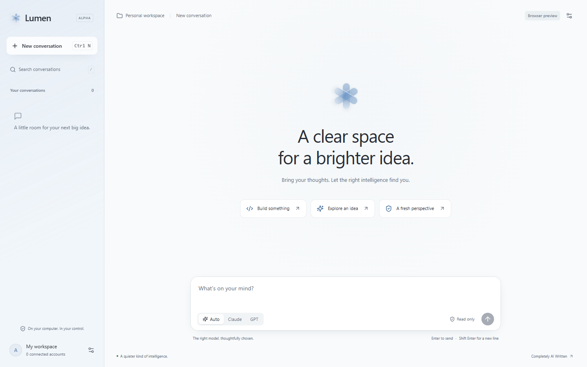
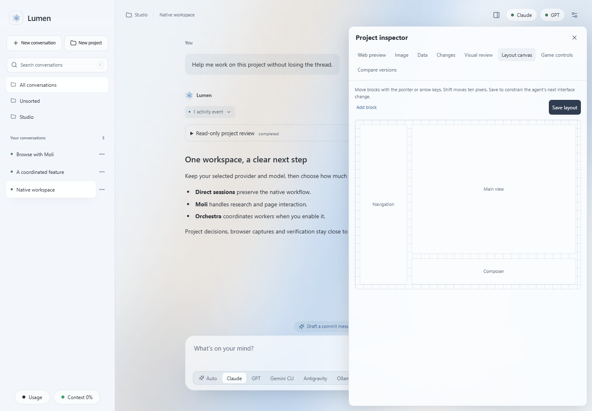

<div align="center">
  
  <h1>Lumen</h1>
  <p><strong>Your AI workspace. Native sessions. A browser built for agents.</strong></p>
  <p>Claude Code · Codex · Antigravity · OpenCode · Cursor · Ollama · Official APIs</p>
  <p>
    <a href="https://github.com/Andrea17982/Lumen/releases/latest">Download 0.9.0</a> ·
    <a href="docs/getting-started.md">Getting started</a> ·
    <a href="docs/README.md">Documentation</a> ·
    <a href="README.it.md">Italiano</a>
  </p>
  <p>
    <a href="https://github.com/Andrea17982/Lumen/actions/workflows/ci.yml"></a>
    <a href="https://github.com/Andrea17982/Lumen/releases"></a>
    <a href="LICENSE"></a>
  </p>
</div>



*A capture of the Windows application with demonstration data. Screenshots show the implemented interface; they are not claims of live model performance.*

Lumen brings your AI coding sessions into one local desktop workspace. Choose a provider and model, continue its native session, and work in the right project folder. Turn on **Orchestra** when you want a coordinated team. **Moli** handles web research and browser automation across supported integrations.

Built with **Tauri 2, Rust, React and TypeScript**, with English and Italian interfaces, light/dark themes, local conversation storage and official provider authentication. Lumen is an independent community project. Version 0.9 remains an alpha release; supported integrations and platform checks have explicit limits.

## 0.9 — Official APIs and adapter compatibility

OpenAI, Anthropic and Google API accounts use the OS keychain, common tools and durable estimated-cost budgets; paid Auto use requires explicit opt-in. OpenCode now uses official ACP with session-scoped permissions, shared Moli/graph/MCP and native continuation. Task difficulty survives “Prosegui.”, quota recovery preserves partial work, and the capability matrix states each adapter’s limits. Cursor remains explicitly selected in Autopilot. [0.9 changelog and limits](docs/release-notes/0.9.0.md).

## Toward 1.0

The [1.0 roadmap revised on 16 November](docs/roadmap-1.0.md) prioritizes reliable collaboration across Claude Code, Codex, Antigravity and OpenCode, plus official Anthropic/OpenAI/Google APIs. Auto may use API credit only after explicit enablement with a mandatory budget. A local daemon, automatic project memory with approved global memory, verifiable handoffs and recoverable autonomy support that workflow. Remote 1.0 means chat, new tasks, Stop/Resume and approvals over LAN/VPN; the full mobile workspace and E2EE relay follow after 1.0. The API/OpenCode compatibility milestone is delivered in 0.9; daemon, memory, expanded collaboration and remote control remain roadmap work.

## Native workspace features

| Native work, with less friction | Tools that stay close to your project |
| --- | --- |
| Auto starts ready; explicit provider/model choices are preserved. | Moli is bundled and automatically connected, including Orchestra workers. |
| Native questions, choices, child-agent output and real-time activity. | Project inspector, image zoom/grid, JSON/SQLite inspection and layout canvas. |
| Autopilot proceeds without repeated Lumen planning approvals. | Manual Both merges and side-by-side static worktree previews. |
| Native Claude/Codex continuation, durable task state and explicit folder changes. | Optional diagnostics, affected-project checks and opt-in Godot controls. |
| Work continues when you close to the notification area. | Windows, universal macOS and Linux packages. |

Read the [0.9 changelog](docs/release-notes/0.9.0.md), [feature guide](docs/features.md) and [validation record](docs/validation.md). The [release history](docs/release-notes/README.md) retains earlier performance and native-session results.

## Choose how to work

**Direct session** — select Claude, GPT/Codex, Antigravity, OpenCode, Cursor, Ollama or an official API adapter. Pick an account, an available model and its supported reasoning level. Claude uses its bidirectional native stream; Codex uses app-server. Google providers retain their official print runners. Ollama uses its official local API.

**Auto** — ask Lumen to choose a provider/model from the connected catalogs, with Budget, Default or Quality preferences and optional independent review. Additional stages consume provider quota.

**Orchestra** — explicitly enable the orchestrator for larger tasks. Review dependencies and agent assignments, then let workers use isolated Git worktrees. Approved execution and Autopilot do not create another plan-approval loop. Limits, stop, integration and interrupted-run recovery are visible.

**Both** — compare Claude and Codex side by side in read-only mode. Retained worktree results can be inspected and merged through per-file/manual choices where applicable.


*Demonstration task graph in the actual interface. Native child-agent sessions and Orchestra workers are distinct capabilities.*

## One browser across providers

The local 0.9 release adds shared Moli tools to OpenCode through ACP and to the three official API adapters. Cursor retains its own native tools without this bridge. [Support matrix](docs/integrations.md).

Moli starts only when a browser tool is needed. It provides Markdown retrieval, search, persistent navigation, DOM interaction and screenshots through Lumen's shared browser service. Conversation/worker contexts are isolated; native authentication remains with each provider.

Ollama gets a real tool/result loop through `localhost`, including a JSON-action fallback for conversational models without native function calling. No inference API key or remote Ollama service is required. Antigravity receives saved full-resolution image paths through its native file/image flow to avoid an observed inline-MCP image stall; Lumen still displays the complete PNG.


*Moli browser capture displayed in Lumen. Website compatibility, CAPTCHA and rendering limits still apply. Moli is not a guarantee of better model reasoning or an exponential end-to-end speedup.*

See [browser tools, routing and measured limits](docs/moli.md).

## Inspect, refine and continue



The project inspector brings source changes, project checks, visual review, image inspection, local web preview and a layout canvas beside the conversation. Godot controls are optional and verify the connected project before editor actions. Purchased addons are not bundled.

Context estimates use a local tokenizer; provider-reported usage remains distinct. A durable task ledger preserves requirements and decisions across truncation, Compact and Rewind. Native continuation sends the new request rather than replaying the entire conversation unnecessarily.

## Download and start

Get **[Lumen 0.8.0 from Releases](https://github.com/Andrea17982/Lumen/releases/latest)**:

| Platform | Package | Notes |
| --- | --- | --- |
| Windows x64 | `Lumen_0.9.0_x64-setup.exe` | Installer; uses Microsoft Edge WebView2. |
| Windows x64 portable | `Lumen_0.9.0_x64-portable.zip` | Extract the **whole ZIP**. Keep `resources` beside `Lumen.exe`. |
| macOS | Universal `.dmg` | Intel and Apple silicon. |
| Linux x64 | `.deb` / `.AppImage` | Built on Ubuntu 24.04; native display/capture compatibility varies. |

Packages are unsigned. Verify downloads with the release's `SHA256SUMS.txt`. Provider CLIs and local Ollama models are installed separately; Moli is included.

1. Install the official provider CLI you want to use, or start local Ollama with an installed model.
2. Open **Settings → Accounts**, add an account and complete its official login. Ollama needs no login.
3. Choose a project folder and a direct provider. Expand provider options to choose the model/reasoning level.
4. Choose permissions and send your request. **Read only** is the initial permission mode; **Autopilot** authorizes the available tools under your OS account.
5. Enable Orchestra separately when the task benefits from coordinated workers.

[Setup and troubleshooting](docs/getting-started.md) · [Accounts](docs/accounts.md) · [Permissions and folders](docs/workspace-models-permissions.md)

## Build from source

Prerequisites: Node.js 22.12+ (or supported Node 24), stable Rust and the [Tauri platform prerequisites](https://v2.tauri.app/start/prerequisites/).

```sh
git clone https://github.com/Andrea17982/Lumen.git
cd Lumen
npm ci
npm run tauri dev
```

The build prepares the pinned, checksum-verified Moli binary and license notices automatically. `npm run dev` is a UI-only preview: it does not authenticate or generate AI responses. On Windows, `npm run build:release` creates the installer and portable ZIP in `builds/latest/`. See [development and release checks](docs/development.md) for all platforms.

## What has been checked

The 0.8 candidate passed **203 Rust Windows tests, 72 frontend unit tests, 40 browser tests and 56 native Windows scenarios**, plus formatting/Clippy and version/documentation checks. The native scenarios use isolated offline provider/API fixtures. Installed-CLI MCP metadata interoperability is checked separately without inference. CI and package helper checks cover Windows, macOS and Linux.

The live ledger remains 13 historical slots, with no additional inference or login for this release closure. Real non-Windows desktop/accessibility checks, the broader account/version matrix and proprietary connector portability remain explicit limits. Fixtures and builds are distinct from those checks. See [validation and known limits](docs/validation.md), [integration support](docs/integrations.md) and the [1.0 roadmap](docs/roadmap-1.0.md).

Autopilot has broad access. Lumen does not add a common OS jail or encrypt its database; use OS permissions and disk encryption. Native CLIs retain their own policies. Moli routing disables supported built-in alternatives, but unrestricted shells/external tools are not an OS network sandbox. [Security and privacy](SECURITY.md).

## Documentation

- [Getting started](docs/getting-started.md) — install, first session, shortcuts and recovery.
- [Features and working modes](docs/features.md) — direct sessions, Auto, Orchestra, Both and project tools.
- [Moli](docs/moli.md) — browser integration, Ollama architecture and compatibility.
- [Projects, models and permissions](docs/workspace-models-permissions.md) — workspace changes and native controls.
- [Task quality](docs/task-quality.md) — durable context, diagnostics and impact-aware validation.
- [Shared integrations](docs/integrations.md) — MCP, skills and plugins across providers, with current limits.
- [Validation](docs/validation.md) · [Roadmap 1.0](docs/roadmap-1.0.md) — what is verified and what comes next.
- [Architecture](docs/architecture.md) · [Development](docs/development.md) · [Release history](docs/release-notes/README.md).
- [Contributing](CONTRIBUTING.md) · [Security](SECURITY.md) · [Third-party notices](THIRD_PARTY_NOTICES.md).

## Completely AI Written

Lumen's original application code, interface, tests and documentation are **completely AI Written**, generated by AI under Andrea's direction. Product vision and decisions are human. Credited upstream adaptations and dependencies retain their original authorship and licenses. AI authorship is a disclosure, not an independent correctness/security audit.

### Credits and upstream adaptations

Thank you to **Theo / pingdotgg, T3 Tools Inc. and the T3 Code contributors**. Lumen's development version adapts [T3 Code's command-receipt design](https://github.com/pingdotgg/t3code/blob/375343aaf35133f659435554cd01634bab333a7d/apps/server/src/persistence/OrchestrationCommandReceipts.ts) to Rust/SQLite: persistent duplicate detection, recovered replies and explicit refusal of uncertain replay. Lumen adds payload binding and integrates a transport-only retry into its local IPC; it does not import T3's backend. [Exact sources and modifications](src-tauri/resources/legal/t3code/ADAPTATIONS.md) · [MIT license and notices](THIRD_PARTY_NOTICES.md). These changes are not part of the published 0.9.0 release; no endorsement is implied.

> Thank you to everyone who wants to try Lumen and share how it feels. Feedback, bug reports and ideas are welcome. — Andrea

Lumen is free to download, use and modify under the MIT license. Feedback through [Issues](https://github.com/Andrea17982/Lumen/issues) is already a contribution. Optional [PayPal support](https://www.paypal.com/cgi-bin/webscr?cmd=_donations&business=andreanastrobusiness1999%40gmail.com&currency_code=EUR&item_name=Support%20Lumen) goes to **andreanastrobusiness1999@gmail.com** and unlocks no features.

MIT © 2026 Andrea17982. No affiliation with Apple, Anthropic, OpenAI or the other named providers.

Local Windows release (16 November): [0.9.0 — official API access and adapter compatibility](docs/release-notes/0.9.0.md), with keychain-backed API accounts/budgets and OpenCode ACP/shared tools. Cursor retains explicit Autopilot selection. GitHub packages use portable CPU targets.
