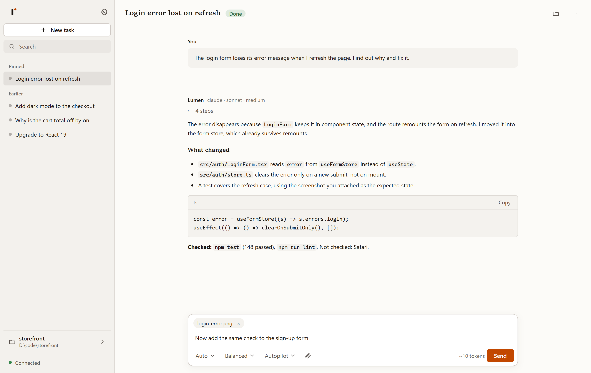
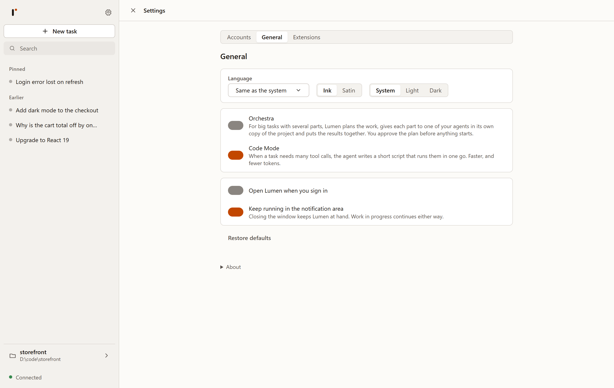
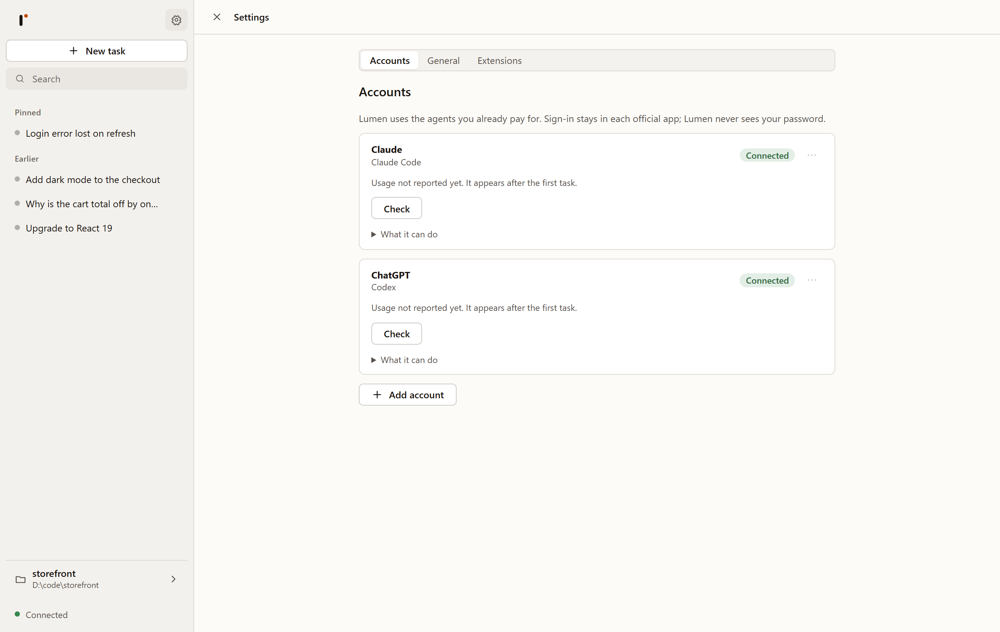

  
  <h1>Lumen</h1>
  
<strong>Another AI subscription hub. This one comes with style and an automatic mode.</strong>

  

    <a href="https://github.com/Andrea17982/Lumen/releases/latest">Download</a> ·
    <a href="docs/README.md">Docs</a> ·
    <a href="README.it.md">Italiano</a>
  

  

    
    
    
  

<picture>
  <source media="(prefers-color-scheme: dark)" srcset="docs/images/conversation-dark.png">
  
</picture>

I built Lumen because I was tired of juggling Claude, ChatGPT and other apps for the same project. Every time I ran out of tokens, I had to switch apps, configure another agent and carry the context across sessions. I wanted to spend less time choosing models and reasoning settings, budgeting tokens and worrying about burning through my quota when context wasn't cached.

Lumen is free, MIT licensed and still in alpha. Try it, fork it, open an issue or send a pull request.

## What it does

- **Picks an agent for you.** Lumen chooses an available agent for your request. When a quota runs out, another agent can pick up where it left off.
- **Lets you choose how agents get permission.** Use read-only access, approve edits as they come up, or enable Autopilot.
- **Splits large tasks with Orchestra.** Once you approve the plan, agents can work in parallel, including across subscriptions.
- **Shares project memory.** Agents read decisions from `LUMEN.md` so the project has one place for shared context.
- **Keeps work running in the background.** You can choose whether Lumen stays in the notification area after you close the window.

Orchestra and **Code Mode** are available in Settings. Code Mode groups tool calls into one script to save tokens and draws on Anthropic's experimental approach. Lumen also uses the Moli browser to reduce the amount of web content agents need to process.

## Download

See the [0.16.0 release](https://github.com/Andrea17982/Lumen/releases/tag/v0.16.0) for available packages and SHA-256 checksums. The release targets Windows x64 setup and portable, macOS universal, and Linux x64 (Debian and Ubuntu). Windows may warn about unsigned packages.

## Build from source

See the [development guide](docs/development.md) for prerequisites, builds and tests.

## Good to know

Autopilot gives agents broad access to your machine and is not a sandbox. Lumen never touches your provider credentials: each CLI signs in on its own, and API keys go to the system keychain. [Validation](docs/validation.md) · [Security](SECURITY.md)

## How it's made

The code, tests and docs are written by Claude Code under my direction; the product decisions are mine. That's a disclosure, not a security audit.

Thanks to **Theo / pingdotgg, T3 Tools Inc. and the T3 Code contributors**: Lumen adapts parts of T3 Code's design. [Sources and changes](src-tauri/resources/legal/t3code/ADAPTATIONS.md) · [Licenses](THIRD_PARTY_NOTICES.md). No endorsement is implied.

Bugs and ideas go in [Issues](https://github.com/Andrea17982/Lumen/issues). If you want to support it there's [PayPal](https://www.paypal.com/cgi-bin/webscr?cmd=_donations&business=andreanastrobusiness1999%40gmail.com&currency_code=EUR&item_name=Support%20Lumen); it doesn't unlock anything. — Andrea

MIT © 2026 Andrea17982. Not affiliated with Anthropic, OpenAI, Google or the other providers named here.
