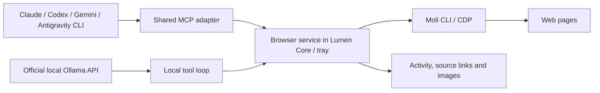

# Moli in Lumen: implementation and evidence, 10 November 2026

Moli is feasible as Lumen's shared browser engine. It is an independent Rust browser kernel with V8, rather than a Chromium launcher. Its main advantage is avoiding layout/paint for document extraction and producing Markdown or semantic trees directly. It cannot make the model itself more intelligent or shorten inference independently of the browser workload. [Architecture and scope](https://github.com/lexmount/moli#architecture).

## What was actually tested

The official Windows x64 **v1.1.23** archive was downloaded without executing the installer script. Its SHA-256 matched the release asset digest: `674652caf89c217c28d988e8eac6e63b4b3991a8dc829124618ead374da11c26`. The binary reports `moli 1.1.23`. Other releases/platforms were not executed locally. [Release](https://github.com/lexmount/moli/releases/tag/v1.1.23).

`tests/moli-probe.mjs` connects Playwright over CDP to a private loopback Moli process. Twelve episodes per engine open a local page, execute JavaScript, fill a field, click through DOM evaluation and read the result. Layout mode also produces a valid PNG, visually inspected. All three paths passed:

| Local synthetic workload | Moli DOM | Moli layout | Chromium |
| --- | ---: | ---: | ---: |
| Connection/startup, one sample | 88 ms | 77 ms | 79 ms |
| Median episode, 12 samples | 60 ms | 59 ms | 90 ms |

This is about **1.5 times** the episode throughput in this small test, with no demonstrated startup advantage. It is not a statistically controlled browser-wide benchmark. RAM, site compatibility and full agent task latency were not measured in this probe. HTTPS Markdown extraction also returned real content from the Rust website. No cookies, existing browser profiles, provider credentials or cloud browser account were used.

The whole conversation improves only in proportion to time spent browsing. For example, if browsing accounts for 20% of a task, a 1.5× faster browser reduces total elapsed time to roughly 93.3% of the original: about 6.7% saved, assuming everything else stays equal. This is an illustrative calculation, not a measured Lumen result. Less noisy page extraction may help the model use its context, but this probe did not measure model-quality improvement.

To repeat, download/verify the official binary, set `LUMEN_MOLI_EXE` to its absolute path, then run `node tests/moli-probe.mjs`. The script closes its own browsers/processes and writes evidence below `.impeccable/review/`.

## Published performance versus guarantees

The project's public 192-URL crawl reports equal median elapsed time for Moli and Chrome (1.43 s), with median RSS of 73 versus 773 MiB. Its separate small agent workload reports lower startup/active time and memory. These are measurements published by the project's own authors, not independent guarantees. [Published benchmarks](https://github.com/lexmount/moli#benchmark).

The authors' separate resource report measures a common-completed task subset; savings on that subset must not be interpreted as a browser-wide success rate or a speedup of an entire Lumen conversation. [Resource methodology](https://github.com/lexmount/Lexbench-Headless-Browser/blob/main/docs/reports/resource-card-20260812.md).

Compatibility remains material: the published five-engine comparison reports 81.88% for an older Moli 0.1.1 against Chrome's 99.85%. Those figures are not a current v1.1.23 acceptance result. Moli explicitly excludes pixel parity with Chrome and high-fidelity Canvas/WebGL/media playback. It is suitable for retrieval and DOM automation; Godot/web-game visual acceptance should retain the real target runtime. [Comparison](https://github.com/lexmount/Lexbench-Headless-Browser/blob/kitesurf-eval/docs/reports/five-engine-report-20260813.md), [current scope](https://github.com/lexmount/moli#project-scope).

## Native integration contract

Lumen uses a browser service in its existing GUI/tray process, exposed to official CLIs through a **single shared MCP adapter** (`lumen_browser`). The same dispatcher serves the official local Ollama API tool loop. No separate daemon, remote browser service, API key or manual per-provider browser setup is needed.

Moli is not a search index. Its supplied search skill visits external search engines through `fetch`. Forcing those routes to replace native search can introduce CAPTCHA, consent pages and variable result quality/latency. Test search discovery and page navigation separately: replacing the browser process alone does not prove better research.

The diagram below describes the implemented architecture. All conversation and Orchestra invocations register a short-lived, authenticated loopback capability before provider execution, including resume and provider fallback. Moli starts only when a browser tool is called.

1. `scripts/prepare-moli.mjs` downloads pinned v1.1.23 archives, verifies their published SHA-256 digests, and bundles the executable with upstream licenses. Repeated builds verify/reuse the local copy. Windows/macOS/Linux packages include resources; universal macOS includes both architectures. Windows portable distribution is now a ZIP containing the executable and its browser resources.
2. Claude/Codex receive invocation-local MCP configuration. Gemini/Antigravity receive a stable entry in their isolated native account settings, preserving unrelated settings. The endpoint and random capability travel through the invocation's environment, never through prompts, project files or persisted native settings. Codex explicitly forwards the two environment variables to its MCP process. No model-name allowlist restricts browser availability.
3. Eight shared tools provide Markdown fetch, search, persistent navigation/extraction, selector click/fill, JavaScript evaluation and PNG screenshot capture. Search visits DuckDuckGo HTML and, when needed, Brave through Moli; it reports blocked/missing result lists. One-shot reads avoid layout/images/fonts. Interactive contexts use CDP, remain separate per conversation/worker/workspace, and survive ordinary native resume or provider switches. Idle contexts are evicted on subsequent registrations, with a bounded idle cache. Quit kills retained browser processes; tray close preserves active work. Context state after a process crash is not a guarantee of restored tabs.
4. Adapters disable Claude WebFetch/WebSearch, Codex built-in search and Gemini search/fetch. Antigravity receives its documented `read_url(*)`/`execute_url(*)` deny rules, preserving other permission settings. Every invocation also receives the Moli routing instruction. Full-access shell commands and independently installed external MCP servers remain available under Autopilot: this integration routes the supported browser path; it is not an OS network jail or a guarantee that an arbitrary model will obey every instruction.
5. The broker enforces access even if a CLI auto-approves MCP discovery/calls: Read only and File edits deny click/fill/evaluate, Autopilot runs directly, and Ask first requires a one-action answer for mutations. Responses, concurrency, URLs, screenshots and deadlines are bounded. Scope termination and MCP cancellation invalidate pending requests; cancelled scripts drop their browser connection instead of reusing stale CDP replies.
6. Browser activity and screenshot previews appear in the transcript, including Orchestra workers. Screenshots are saved in the conversation's project rather than a disposable worktree. Unsupported pages and blocked searches return tool errors; no Chromium/native-search fallback is silently substituted. Page content remains untrusted data.

### Why Ollama uses its local API

Claude/Codex and the Google CLIs receive browser tools through their native MCP integrations. A text-only `ollama run` subprocess cannot implement Lumen's structured tool execution/result loop just by receiving an MCP configuration file.

Ollama's official `/api/chat` supports structured calls and tool-result messages. Lumen executes those calls with the shared browser dispatcher and sends the results back to the same selected local model. Models without native tool capability use a constrained JSON action envelope; invalid output never executes an invented tool. Local model discovery and short title/commit helpers also use the official API. All installed conversational models are selectable, with the pinned/largest model as default. HTTP is restricted to loopback, proxies/redirects are disabled, cloud tags and remote-model metadata are rejected, and no model is automatically pulled. Subscription providers retain their native CLI authentication. This supplies browser capability; it cannot make a model that ignores tools perform reliably. [Ollama tool calling](https://docs.ollama.com/capabilities/tool-calling).

CDP compatibility also needs regression coverage rather than assuming Playwright parity: Playwright documents a lower-fidelity connection than its own protocol; the local probe validates only the methods it exercises. [Playwright CDP documentation](https://playwright.dev/docs/api/class-browsertype#browser-type-connect-over-cdp).

## Integration verification

- Rust tests run the actual bundled Windows Moli against a local JavaScript/form fixture: fetch, navigate, fill, click, evaluate, extract, screenshot, tab reuse across registrations and worker isolation. Authentication, read-only denial and permission cancellation are covered separately.
- Deterministic local Ollama API fixtures verify both native tools and JSON-action fallback: each consumes an actual Moli page result in the next generation request. Catalog tests reject cloud aliases and embedding-only models.
- A real installed `llama3.2:latest` model called Moli and returned the unpredictable identifier present only in the served page. No model was downloaded and no remote inference/key was used.
- A real Codex `gpt-6.1-sol` session inside Lumen navigated, clicked, extracted and saved a PNG through Moli, with no Autopilot question. The next native turn reused the same CLI session and modified Moli tab (about 27 seconds for both turns).
- A real Antigravity `gemini-3.8-flash-high` turn passed navigation, click, extraction, capture and final response in about 29 seconds, without an approval question. Two earlier print turns stalled after an inline MCP image result (original PNG and compact JPEG); the DOM-only control completed in about 22 seconds. The implemented compatibility path keeps/displays the original PNG and returns its absolute path for the CLI's native file/image viewer, rather than inlining image bytes into that CLI's MCP result. Other providers retain standard MCP image blocks. This is a transport workaround, not a reduction in the saved/UI image quality or a browser substitution.
- Browser image activity has a Playwright regression. Native offline fixtures use a local Ollama API simulator. Installed/portable release smoke checks discover eight browser tools and execute the bundled Moli version command without model inference.
- Claude live inference remains deferred by the user's earlier quota decision; Gemini login remains the user's step. Their configuration/protocol tests are not claims of live model acceptance. Non-Windows packaging is verified separately through Actions, not by local runtime tests.

### Completed build acceptance

Functional revision **3ee4635** passed [CI on Windows, macOS and Ubuntu](https://github.com/Andrea17982/Lumen/actions/runs/42843169200): 135 Rust tests (13 environment/account-dependent opt-in tests excluded from the normal suite), 60 TypeScript tests, 29 Playwright tests, rustfmt and Clippy with warnings denied. The real local Ollama browser test was also run separately and passed.

[Packaging on the same source](https://github.com/Andrea17982/Lumen/actions/runs/42843169596) passed for Windows installer/portable ZIP, universal macOS DMG and Linux deb/AppImage. The clean Windows runner installed the package, discovered the graph/browser MCP tools and executed the bundled Moli version check. The local final Windows portable ZIP was independently extracted; its helpers, actual Moli page retrieval and all three local SHA-256 manifest entries passed. This workflow run produced downloadable build artifacts and did not rewrite the existing published 0.6.0 release.
