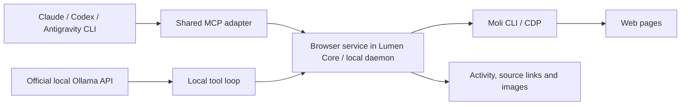

# Moli browser

Moli is Lumen's bundled browser engine for Claude Code, Codex, Antigravity, OpenCode, local Ollama and the three official API adapters. It starts when a browser tool is needed. Cursor's initial adapter retains its native tools without Lumen Moli injection; see the [adapter matrix](integrations.md).

## Native integration contract

Lumen uses a browser service in its local daemon, exposed to official CLIs through a **single shared MCP adapter** (`lumen_browser`). The same dispatcher serves local Ollama and the three official API tool loops. The local daemon starts automatically; no remote browser service, API key or manual per-provider browser setup is needed.

Moli is not a search index. Its supplied search skill visits external search engines through `fetch`. Forcing those routes to replace native search can introduce CAPTCHA, consent pages and variable result quality/latency. Test search discovery and page navigation separately: replacing the browser process alone does not prove better research.

The diagram below describes the implemented architecture. Supported Claude/Codex/Antigravity and Ollama invocations register a short-lived, authenticated loopback capability before provider execution, including resume and provider fallback. Moli starts only when a browser tool is called.

1. `scripts/prepare-moli.mjs` downloads pinned v1.1.23 archives, verifies their published SHA-256 digests, and bundles the executable with upstream licenses. Repeated builds verify/reuse the local copy. Windows/macOS/Linux packages include resources; universal macOS includes both architectures. Windows portable distribution is now a ZIP containing the executable and its browser resources.
2. Claude/Codex receive invocation-local MCP configuration. Antigravity receives a stable entry in its isolated native account settings, preserving unrelated settings. The endpoint and random capability travel through the invocation's environment, never through prompts, project files or persisted native settings. Codex explicitly forwards the two environment variables to its MCP process. No model-name allowlist restricts browser availability.
3. Eight shared tools provide Markdown fetch, search, persistent navigation/extraction, selector click/fill, JavaScript evaluation and PNG screenshot capture. Search visits DuckDuckGo HTML and, when needed, Brave through Moli; it reports blocked/missing result lists. One-shot reads avoid layout/images/fonts. Interactive contexts use CDP, remain separate per conversation/worker/workspace, and survive ordinary native resume or provider switches. Idle contexts are evicted on subsequent registrations, with a bounded idle cache. Stopping the service kills retained browser processes; closing the GUI preserves active work. Context state after a process crash is not a guarantee of restored tabs.
4. Adapters disable Claude WebFetch/WebSearch, and Codex built-in search. Antigravity receives its documented `read_url(*)`/`execute_url(*)` deny rules, preserving other permission settings. Every invocation also receives the Moli routing instruction. Full-access shell commands and independently installed external MCP servers remain available under Autopilot: this integration routes the supported browser path; it is not an OS network jail or a guarantee that an arbitrary model will obey every instruction.
5. The broker enforces access even if a CLI auto-approves MCP discovery/calls: Read only and File edits deny click/fill/evaluate, Autopilot runs directly, and Ask first requires a one-action answer for mutations. Responses, concurrency, URLs, screenshots and deadlines are bounded. Scope termination and MCP cancellation invalidate pending requests; cancelled scripts drop their browser connection instead of reusing stale CDP replies.
6. Browser activity and screenshot previews appear in the transcript, including Orchestra workers. Screenshots are saved in the conversation's project rather than a disposable worktree. Unsupported pages and blocked searches return tool errors; no Chromium/native-search fallback is silently substituted. Page content remains untrusted data.

### Why Ollama uses its local API

Claude/Codex and the Google CLIs receive browser tools through their native MCP integrations. A text-only `ollama run` subprocess cannot implement Lumen's structured tool execution/result loop just by receiving an MCP configuration file.

Ollama's official `/api/chat` supports structured calls and tool-result messages. Lumen executes those calls with the shared browser dispatcher and sends the results back to the same selected local model. Models without native tool capability use a constrained JSON action envelope; invalid output never executes an invented tool. Local model discovery and short title/commit helpers also use the official API. All installed conversational models are selectable, with the pinned/largest model as default. HTTP is restricted to loopback, proxies/redirects are disabled, cloud tags and remote-model metadata are rejected, and no model is automatically pulled. Subscription providers retain their native CLI authentication. This supplies browser capability; it cannot make a model that ignores tools perform reliably. [Ollama tool calling](https://docs.ollama.com/capabilities/tool-calling).

CDP compatibility also needs regression coverage rather than assuming Playwright parity: Playwright documents a lower-fidelity connection than its own protocol; the local probe validates only the methods it exercises. [Playwright CDP documentation](https://playwright.dev/docs/api/class-browsertype#browser-type-connect-over-cdp).

## Validation and limits

Rust tests exercise the bundled Moli against local JavaScript/form fixtures, including navigation, extraction, screenshots, permissions, cancellation and conversation/worker isolation. Local Ollama fixtures verify both native tool calls and the JSON-action loop. Native package checks verify helper discovery and the bundled browser. [Current release evidence](validation.md) distinguishes these checks from historical account smoke tests.

Page content is untrusted input. Search can encounter CAPTCHA, consent pages or unavailable results. Moli does not promise pixel parity with Chromium or complete Canvas/WebGL/media compatibility; use the actual target runtime for game/visual acceptance. Browser performance is not a model-reasoning or end-to-end task-quality guarantee. [Upstream architecture and scope](https://github.com/lexmount/moli#architecture).

The earlier feasibility study, synthetic timings, upstream comparisons and 0.7 build receipts are historical, not current measurements. They remain in the [0.8.0 source snapshot](https://github.com/Andrea17982/Lumen/blob/v0.8.0/docs/moli.md).
