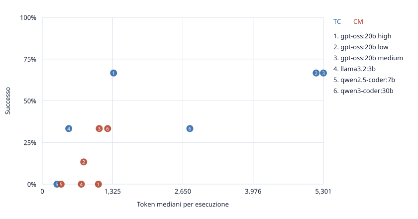

# Code Mode · primo gate

186 esecuzioni registrate. Costo di inferenza totale 0 USD.

Nessuna cella T1 qualifica Code Mode come default. Qwen3-Coder riduce i token mediani del 55,7% e rimane a 5/15 successi. Vince tutte e cinque le prove di modifica della suite A entro il cap del benchmark e perde tutte e cinque le prove di filtro della suite B. La compensazione rende inconcludente l'intervallo di qualità aggregato.

| Tier | Modello | Effort | Suite | Braccio | Successi | Token in/out mediani | Token totali p90 | Round-trip med/p90 | TTFT med (ms) | Tempo med/p90 (s) | Errori script/tool |
| --- | --- | --- | --- | --- | ---: | ---: | ---: | ---: | ---: | ---: | ---: |
| T0 | scripted | default | A | TC | 1/1 | 7856/1087 | 8943 | 5/5 | n.d. | 0.38/0.38 | 0/0 |
| T0 | scripted | default | A | CM | 1/1 | 700/148 | 848 | 2/2 | n.d. | 0.04/0.04 | 0/0 |
| T0 | scripted | default | B | TC | 1/1 | 2083/92 | 2175 | 2/2 | n.d. | 0.02/0.02 | 0/0 |
| T0 | scripted | default | B | CM | 1/1 | 650/120 | 770 | 2/2 | n.d. | 0.01/0.01 | 0/0 |
| T0 | scripted | default | C | TC | 1/1 | 540/65 | 605 | 2/2 | n.d. | 0.35/0.35 | 0/0 |
| T0 | scripted | default | C | CM | 1/1 | 652/104 | 756 | 2/2 | n.d. | 0.20/0.20 | 0/0 |
| T1 | gpt-oss:20b | high | A | CM | 0/5 | 290/768 | 1058 | 1/1 | 268 | 30.26/31.16 | 0/0 |
| T1 | gpt-oss:20b | high | A | TC | 0/5 | 458/886 | 1344 | 2/2 | 789 | 34.99/35.71 | 0/0 |
| T1 | gpt-oss:20b | high | B | TC | 5/5 | 5025/435 | 5460 | 5/5 | 772 | 19.52/19.62 | 0/0 |
| T1 | gpt-oss:20b | high | B | CM | 0/5 | 617/981 | 1689 | 2/3 | 258 | 41.42/47.85 | 0/7 |
| T1 | gpt-oss:20b | high | C | TC | 5/5 | 995/337 | 1333 | 4/4 | 260 | 15.12/15.46 | 0/0 |
| T1 | gpt-oss:20b | high | C | CM | 0/5 | 286/768 | 1054 | 1/1 | 268 | 30.32/30.70 | 0/0 |
| T1 | gpt-oss:20b | low | A | CM | 2/5 | 639/142 | 2250 | 2/3.6 | 254 | 17.04/20.40 | 3/2 |
| T1 | gpt-oss:20b | low | A | TC | 0/5 | 6258/448 | 6706 | 12/12 | 798 | 23.61/53.93 | 0/5 |
| T1 | gpt-oss:20b | low | B | TC | 5/5 | 5025/138 | 5163 | 5/5 | 776 | 8.79/9.44 | 0/0 |
| T1 | gpt-oss:20b | low | B | CM | 0/5 | 617/69 | 686 | 2/2 | 742 | 3.82/4.15 | 0/5 |
| T1 | gpt-oss:20b | low | C | TC | 5/5 | 995/72 | 1067 | 4/4 | 260 | 5.24/5.49 | 0/0 |
| T1 | gpt-oss:20b | low | C | CM | 0/5 | 1448/357 | 1805 | 4/4 | 283 | 15.96/17.62 | 0/12 |
| T1 | gpt-oss:20b | medium | A | CM | 5/5 | 1956/578 | 2538 | 3/3 | 267 | 24.53/25.67 | 5/0 |
| T1 | gpt-oss:20b | medium | A | TC | 0/5 | 6213/833 | 7046 | 12/12 | 776 | 37.37/37.87 | 0/0 |
| T1 | gpt-oss:20b | medium | B | TC | 5/5 | 5025/276 | 5301 | 5/5 | 760 | 13.62/14.09 | 0/0 |
| T1 | gpt-oss:20b | medium | B | CM | 0/5 | 617/456 | 1073 | 2/2 | 809 | 18.76/19.40 | 0/5 |
| T1 | gpt-oss:20b | medium | C | TC | 5/5 | 995/207 | 1216 | 4/4 | 261 | 10.47/10.97 | 0/0 |
| T1 | gpt-oss:20b | medium | C | CM | 0/5 | 622/322 | 944 | 2/2 | 799 | 13.96/14.33 | 0/5 |
| T1 | llama3.2:3b | default | A | CM | 0/5 | 556/180 | 752 | 2/2 | n.d. | 2.15/4.22 | 0/100 |
| T1 | llama3.2:3b | default | A | TC | 0/5 | 251/600 | 851 | 1/1 | n.d. | 6.78/6.82 | 0/0 |
| T1 | llama3.2:3b | default | B | TC | 0/5 | 356/102 | 458 | 2/2 | n.d. | 1.18/1.19 | 0/5 |
| T1 | llama3.2:3b | default | B | CM | 0/5 | 313/26 | 339 | 1/1 | 322 | 0.33/0.34 | 0/0 |
| T1 | llama3.2:3b | default | C | TC | 5/5 | 456/42 | 498 | 2/2 | n.d. | 1.05/1.23 | 0/0 |
| T1 | llama3.2:3b | default | C | CM | 0/5 | 323/768 | 1091 | 1/1 | 8681 | 8.68/8.73 | 0/0 |
| T1 | qwen2.5-coder:7b | default | A | CM | 0/5 | 325/35 | 360 | 1/1 | 106 | 0.84/3.46 | 0/0 |
| T1 | qwen2.5-coder:7b | default | A | TC | 0/5 | 256/35 | 291 | 1/1 | 44 | 0.78/0.82 | 0/0 |
| T1 | qwen2.5-coder:7b | default | B | TC | 0/5 | 203/73 | 276 | 1/1 | 45 | 1.60/1.63 | 0/0 |
| T1 | qwen2.5-coder:7b | default | B | CM | 0/5 | 313/29 | 342 | 1/1 | 98 | 0.71/0.72 | 0/0 |
| T1 | qwen2.5-coder:7b | default | C | TC | 0/5 | 237/34 | 271 | 1/1 | 44 | 0.76/0.80 | 0/0 |
| T1 | qwen2.5-coder:7b | default | C | CM | 0/5 | 321/34 | 355 | 1/1 | 109 | 0.83/0.83 | 0/0 |
| T1 | qwen3-coder:30b-a3b-q4_K_M | default | A | CM | 5/5 | 2960/535 | 3495 | 3/3 | 143 | 21.38/31.22 | 0/0 |
| T1 | qwen3-coder:30b-a3b-q4_K_M | default | A | TC | 0/5 | 10661/608 | 13591 | 12/12 | 1118 | 26.52/37.12 | 0/0 |
| T1 | qwen3-coder:30b-a3b-q4_K_M | default | B | TC | 5/5 | 2679/103 | 2782 | 2/2 | n.d. | 8.33/8.45 | 0/0 |
| T1 | qwen3-coder:30b-a3b-q4_K_M | default | B | CM | 0/5 | 1063/169 | 1263 | 2/2 | n.d. | 7.51/8.10 | 0/0 |
| T1 | qwen3-coder:30b-a3b-q4_K_M | default | C | TC | 0/5 | 814/44 | 858 | 2/2 | n.d. | 2.69/3.27 | 0/0 |
| T1 | qwen3-coder:30b-a3b-q4_K_M | default | C | CM | 0/5 | 1014/75 | 1089 | 2/2 | n.d. | 4.11/4.12 | 0/15 |

## Gate T1

| Modello / effort | Coppie | Successi TC → CM | Δ qualità (IC 95%) | Risparmio token | Risparmio round-trip | McNemar p | Wilcoxon token p | Esito |
| --- | ---: | ---: | ---: | ---: | ---: | ---: | ---: | --- |
| gpt-oss:20b / high | 15/15 | 10 → 0 | -66.7 pp [-66.7, -66.7] | +21.3% | +75.0% | 0.00195 | 6.1e-05 | Qualità sotto soglia |
| gpt-oss:20b / low | 15/15 | 10 → 2 | -53.3 pp [-66.7, -40.0] | +84.9% | +60.0% | 0.0386 | 0.00635 | Qualità sotto soglia |
| gpt-oss:20b / medium | 15/15 | 10 → 5 | -33.3 pp [-33.3, -33.3] | +79.8% | +60.0% | 0.302 | 6.1e-05 | Qualità sotto soglia |
| llama3.2:3b / default | 15/15 | 5 → 0 | -33.3 pp [-33.3, -33.3] | -47.8% | +50.0% | 0.0625 | 0.805 | Qualità sotto soglia |
| qwen2.5-coder:7b / default | 15/15 | 0 → 0 | +0.0 pp [+0.0, +0.0] | -28.6% | +0.0% | 1 | 6.1e-05 | Efficienza sotto soglia |
| qwen3-coder:30b-a3b-q4_K_M / default | 15/15 | 5 → 5 | +0.0 pp [+0.0, +0.0] | +55.7% | +0.0% | 1 | 0.00861 | IC bootstrap degenerato |



- gpt-oss:20b / high · IC 95% Δ mediana appaiata CM−TC, [-286, -286] token e [-3, -2] round-trip.
- gpt-oss:20b / low · IC 95% Δ mediana appaiata CM−TC, [-4483, -4160] token e [-3, -3] round-trip.
- gpt-oss:20b / medium · IC 95% Δ mediana appaiata CM−TC, [-4228, -4228] token e [-3, -3] round-trip.
- llama3.2:3b / default · IC 95% Δ mediana appaiata CM−TC, [-115, -88] token e [-1, -1] round-trip.
- qwen2.5-coder:7b / default · IC 95% Δ mediana appaiata CM−TC, [69, 69] token e [0, 0] round-trip.
- qwen3-coder:30b-a3b-q4_K_M / default · IC 95% Δ mediana appaiata CM−TC, [-1550, -1498] token e [0, 0] round-trip.

## Errori del runner

- 15 × `benchmark step cap reached`
- 5 × `Ollama native per-step tool cap exceeded`
- 2 × `error parsing tool call: raw='The user wants to scan shards 0, 1, 2, and 3 of the log using the available tools. The tool is bench_scan_log. The user says "Scan shards 0, 1, 2 and 3 of the log using the available tools. Sum the units from the PAID entries only and answer with that integer alone."

We attempted to call bench_scan_log with shard 0, but it returned an error: "Tool is outside the advertised arm". That suggests that the tool is not available or not allowed. The user might be expecting us to use the tool, but the tool is not available. We need to handle this gracefully.

We need to respond with the sum of units from PAID entries only. But we cannot get the log data because the tool is not available. We might need to explain that we cannot access the log. But the user specifically says "answer with that integer alone." So we need to provide an integer. But we cannot compute it because we don't have the data. We might need to ask for clarification or explain that we cannot access the log. But the user specifically wants the integer. We might need to respond with an error or a placeholder. But the instruction says "answer with that integer alone." That is contradictory if we cannot compute it. We might need to respond with an error message or "0" if we assume no PAID entries. But that would be wrong.

We need to consider the policy. The user is requesting a calculation. We cannot do it because we cannot access the log. We should explain that we cannot access the log. But the user specifically wants the integer alone. That might be a conflict. The policy says we should not provide incomplete or incorrect answers. We should not provide a random integer. We should explain that we cannot access the log. The user might be expecting us to do something else. But we cannot do it.

We should respond with an explanation that we cannot access the log due to tool restrictions. The user might want us to do something else. But we cannot. So we should politely explain that we cannot access the log. The user might want us to do something else. But we cannot. So we should respond with an explanation. The policy says we should not provide incomplete or incorrect answers. So we should not provide a random integer. We should explain that we cannot access the log. The user might want us to do something else. But we cannot. So we should respond with an explanation.

Thus, we should respond with a short explanation that we cannot access the log. The user specifically wants the integer alone, but we cannot provide it. So we should politely explain that we cannot access the log. That is the best approach.', err=invalid character 'T' looking for beginning of value`
- 1 × `HTTP status server error (500 Internal Server Error) for url (http://127.0.0.1:11435/api/chat)`

## Metodo e limiti

- T0 usa risposte Axum scriptate e un'asserzione in CI su round-trip, esiti e dimensione del contesto. I token T0 sono stime tiktoken o200k sui payload. Il replay TC usa batch nativi fino a 16 call.
- T1 usa le API Ollama in loopback con temperatura 0, finestra impostata a 8.192 token, 768 token di generazione per richiesta e fino a 12 round-trip per prova. I bracci si alternano entro coppie con gli stessi task e seed. I tentativi generati dal modello fanno parte della misura.
- Fixture isolate per braccio. A modifica e verifica 20 file. B filtra quattro finestre da quattro shard di un file sintetico da 50 MB. C esegue tre processi Node controllati, con fallimento atteso della build. Code Mode usa il motore F1 e il catalogo del benchmark. Il ramo C permette il fan-out di tre comandi fissi e indipendenti, mentre F1 serializza richieste shell arbitrarie.
- T1 usa i conteggi Ollama, compreso il reasoning nel totale di generazione se contato dal backend. Il reasoning separato è stimato con tiktoken o200k e non si somma al totale. TTFT osserva il primo frammento visibile di testo o reasoning della prima richiesta, quindi può mancare per richieste con sole call. La cache non è osservata. Il tempo include il caricamento del modello se il worker è freddo.
- Bootstrap appaiato a blocchi per seed. Con pochi seed e fixture ripetute, la stima è esplorativa. Un IC percentile [0,0] da differenze costanti o da successi e fallimenti che si compensano tra suite non dimostra il margine del −2 pp. I p-value sono descrittivi.
- Il gate di sicurezza di F1 è verificato dai test Rust sul dispatch. Suite H estesa e qualità dei provider a pagamento restano da misurare.

## Riproduzione

In PowerShell, dal checkout, imposta `LUMEN_BENCH_OUTPUT` al nuovo `results.jsonl` nella cartella del report. T0 gira anche nei test ordinari.

```powershell
cargo test --manifest-path src-tauri/Cargo.toml -p lumen-core --locked bench_t0 -- --nocapture
$env:LUMEN_BENCH_URL = 'http://127.0.0.1:11434'
$env:LUMEN_BENCH_MODELS = 'llama3.2:3b,qwen2.5-coder:7b,qwen3-coder:30b-a3b-q4_K_M'
$env:LUMEN_BENCH_EFFORT = 'default'
cargo test --manifest-path src-tauri/Cargo.toml -p lumen-core --locked bench_t1 -- --ignored --nocapture
$env:LUMEN_BENCH_MODELS = 'gpt-oss:20b'
foreach ($effort in 'low','medium','high') {
  $env:LUMEN_BENCH_EFFORT = $effort
  cargo test --manifest-path src-tauri/Cargo.toml -p lumen-core --locked bench_t1 -- --ignored --nocapture
}
python scripts/summarize-code-mode.py reports/bench/2026-11-18
```

## Ambiente misurato

Ollama 0.40.16 su Windows x64, Intel Core i9-13980HX, 31,8 GiB RAM e NVIDIA RTX 2000 Ada Laptop con 8 GiB VRAM. Una sessione di inferenza alla volta su loopback con cloud disabilitato. Il test e Clippy del workspace sono stati eseguiti localmente su Windows.

| Tag Ollama | Digest manifest | Byte |
| --- | --- | ---: |
| llama3.2:3b | a52a4a87c5af | 2.019.394.194 |
| qwen2.5-coder:7b | dae161e27b0e | 4.683.087.561 |
| gpt-oss:20b | f38aa0c53da5 | 13.793.441.566 |
| qwen3-coder:30b-a3b-q4_K_M | 06c1097efce0 | 18.556.700.761 |
